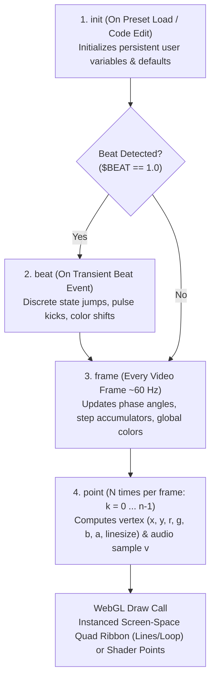

# Duperscope Component Specification

> **Component Type:** `duperscopeNode`  
> **Status:** Active in Track 5 (Generative Visual Synthesis & Duperscope)

## 1. Overview & Vision

**Duperscope** is Visualització's modern reinterpretation of the iconic **Superscope** component from Winamp AVS (Advanced Visualization Studio).

In Winamp AVS, Superscope was celebrated as the most expressive generative component: a programmable parametric curve and particle generator that evaluates user mathematical expressions at high framerates (60+ FPS) to position, animate, and color vertices based on audio waveform and frequency spectrum data.

Duperscope brings this capability into WebGL / Three.js, supporting Visualització's global expression system, coordinate conventions, and a 4-phase code execution lifecycle.

---

## 2. Architecture & Execution Lifecycle

Duperscope runs 4 distinct evaluation phases to balance performance, state maintenance, and per-vertex calculation. Notably, **`beat` executes before `frame`** on beat frames so any beat-triggered state impulses are immediately visible to `frame` logic on the same frame:



### Execution Lifecycle Phases

| Phase | When It Executes | Typical Purpose | Frequency |
| :--- | :--- | :--- | :--- |
| **`init`** | Once when the preset loads, or when the user edits script code. | Declaring initial state variables, persistent counters, constant values. | 1 time |
| **`beat`** | Once at the start of a frame if and only if a beat transient is detected (`$BEAT === 1.0`). | Triggering beat flashes, discrete angular jumps, step-advancing state before `frame` runs. | Audio-driven (~1–3 Hz) |
| **`frame`** | Once per render frame (immediately after `beat` on beat frames) before drawing vertices. | Animating global rotations, calculating elapsed time offsets, smoothing beat impulses, updating base colors. | ~60 Hz |
| **`point`** | $N$ times per frame ($k = 0$ to $n - 1$). | Parametric equations for vertex coordinate $(x, y)$, color $(r, g, b, a)$, stroke/point size (`linesize`), and audio displacement. | $N \times 60\text{ Hz}$ (e.g. 60–245,760 evals/sec) |

---

## 3. Coordinate System & Color Range

- **Screen Coordinates ($x, y$):**
  - Range $[-1.0, 1.0]$ with `(0.0, 0.0)` at the center of the viewport.
  - **1:1 Square Aspect Projection (Always Active):** The horizontal coordinate $x$ is automatically divided by `$ASPECT` (`width / height`) during projection so that $[-1.0, 1.0]$ represents a true 1:1 square centered in the viewport. Parametric circles (`x = cos(t); y = sin(t)`) always render as true circles rather than horizontal ellipses. (Users wishing to span the full horizontal width of a widescreen viewport can multiply `x` by `$ASPECT` in their script.)
- **Color Channels ($r, g, b, a$):** Range $[0.0, 1.0]$ (clamped prior to buffer write). `a` defaults to `1.0`.

---

## 4. Variable & Function Scope

### A. Duperscope Built-in Scope Variables

| Variable | Scope / Phase | Access | Description |
| :--- | :--- | :--- | :--- |
| `n` | `init`, `beat`, `frame`, `point` | **Read / Write** in `init`, `beat`, `frame`; **Read-Only** in `point` | **Total point count** (Default: `200`, Clamped integer range: `1` to `4096`). Modifiable dynamically in `init`, `beat`, or `frame`. Setting `n = 1` allows drawing a single reactive dot. |
| `i` | `point` | **Read-Only** | **Normalized point index** from `0.0` to `1.0` (computed before each point $k$ as `n > 1 ? k / (n - 1) : 0.0`). |
| `v` | `point` | **Read-Only** | **Current point audio sample** at normalized position `i` according to `audioMode` (Waveform: $[-1.0, 1.0]$, Spectrum: $[0.0, 1.0]$). Fast zero-overhead shorthand for `#WAVEFORM(i)` or `#FFT(i)`. |
| `x` | `point` | **Read / Write** | **Output horizontal position** $[-1.0, 1.0]$. Reset before each point iteration to `(i * 2.0) - 1.0`. |
| `y` | `point` | **Read / Write** | **Output vertical position** $[-1.0, 1.0]$. Reset before each point iteration to `0.0`. |
| `r` | `init`, `beat`, `frame`, `point` | **Read / Write** | **Red color channel** $[0.0, 1.0]$ (Initial default: `1.0`). Persists across phases unless overwritten. |
| `g` | `init`, `beat`, `frame`, `point` | **Read / Write** | **Green color channel** $[0.0, 1.0]$ (Initial default: `1.0`). Persists across phases unless overwritten. |
| `b` | `init`, `beat`, `frame`, `point` | **Read / Write** | **Blue color channel** $[0.0, 1.0]$ (Initial default: `1.0`). Persists across phases unless overwritten. |
| `a` | `init`, `beat`, `frame`, `point` | **Read / Write** | **Alpha transparency** $[0.0, 1.0]$ (Initial default: `1.0`). Persists across phases unless overwritten. |
| `linesize` | `init`, `beat`, `frame`, `point` | **Read / Write** | **Line stroke width / particle point diameter in pixels** (Initial default: `1.0`, Clamped range: `1.0` to `128.0`). Persists across phases unless overwritten. |
| `skip` | `point` | **Read / Write** | **Segment / point skip flag** (Reset before each point iteration to `0.0`). If set to `> 0.0` in `point`, that point/segment is omitted (alpha zeroed). |

### B. State Initialization & Per-Point Reset Rules
1. **When `init` runs (on preset load or any script edit):**
   - The persistent user variable dictionary is reset.
   - Built-in defaults are initialized: `n = 200`, `r = 1.0`, `g = 1.0`, `b = 1.0`, `a = 1.0`, `linesize = 1.0`.
   - The `init` script executes once.
2. **Each Frame:**
   - System variables (`$TIME`, `$BASS`, etc.) are updated in scope from `FrameContext`.
   - If `context.$BEAT === 1.0`, the `beat` script executes.
   - The `frame` script executes.
   - `n` is read from scope and clamped to an integer in `[1, 4096]`.
3. **Each Point ($k = 0 \dots n - 1$):**
   - Before evaluating `point`:
     - `i = n > 1 ? k / (n - 1) : 0.0`
     - `v = sampleAudio(i, audioMode, channel)`
     - `x = (i * 2.0) - 1.0`
     - `y = 0.0`
     - `skip = 0.0`
     - `r`, `g`, `b`, `a`, `linesize`, and all custom user variables retain their current values in scope.
   - The `point` script executes.

### C. System Variables, Functions & Math
- All standard Visualització system variables (`$VARIABLE`) and functions (`#FUNCTION(...)`) can be referenced in any code block.
- For advanced multi-band sampling within the same script, scripts can call `#FFT(position, bandwidth, channel)` or `#WAVEFORM(position, channel)` anywhere in `beat`, `frame`, or `point`.

---

## 5. Audio Source Configuration

Duperscope allows selecting the primary audio stream sampled by the automatic `v` variable:

1. **Audio Mode (`audioMode`):**
   - `'waveform'` (Time-domain oscilloscope data): $v \in [-1.0, 1.0]$.
   - `'spectrum'` (Frequency-domain FFT data): $v \in [0.0, 1.0]$, using **logarithmic frequency mapping** (`20 Hz` to `20,000 Hz`, matching `#FFT(i)`) so octaves are distributed evenly across $i \in [0.0, 1.0]$.
2. **Audio Channel (`channel`):**
   - `'center'` (Mono mixdown: $(L + R) / 2$)
   - `'left'` ($L$ channel)
   - `'right'` ($R$ channel)
   - *Implementation Note:* Matching `#FFT` and `#WAVEFORM`, `'center'`, `'left'`, and `'right'` all sample the primary `AudioAnalyzer` mono mixdown stream until stereo channel splitting is introduced.

---

## 6. Rendering & Geometry Modes

Duperscope supports 3 draw modes with full support for per-vertex color `(r, g, b, a)` and per-vertex thickness `linesize`:

| Draw Mode (`drawMode`) | Geometry Strategy | Visual Appearance |
| :--- | :--- | :--- |
| `'lines'` (Default) | **Instanced Screen-Space Quad Ribbon** ($n - 1$ segments) | Continuous connected polyline through points $0 \dots n-1$ with variable stroke thickness (`linesize` in pixels) and smooth RGBA gradients. |
| `'lineLoop'` | **Instanced Screen-Space Quad Ribbon** ($n$ segments) | Closed continuous polyline connecting point $n-1$ back to point $0$ with variable stroke thickness (`linesize` in pixels). |
| `'points'` | **Custom `THREE.Points` Shader** ($n$ vertices) | Anti-aliased circular particles at each point. Diameter controlled per-point by `linesize` (`gl_PointSize = linesize * uPixelRatio`). When `n = 1`, renders a single controllable particle. |

### Why Instanced Screen-Space Quad Ribbons for Lines?
In WebGL across Windows (ANGLE / Direct3D 11) and macOS (Metal), the underlying GPU drivers hard-cap native `gl.lineWidth()` at **`1.0px`**, causing `THREE.LineBasicMaterial({ linewidth })` to ignore any thickness greater than 1 pixel.
- By rendering line segments using a pre-allocated **`THREE.InstancedBufferGeometry`** where each instance represents one segment $[P_k, P_{k+1}]$ expanded into a screen-space quad along its 2D perpendicular normal by `linesize * 0.5` pixels:
  1. `linesize` works reliably from `1px` to `128px` on every OS, browser, and GPU.
  2. Each vertex can dynamically modulate `linesize` and `(r, g, b, a)` along the curve.
  3. All up to 4,096 segments render in a **single WebGL draw call** with zero per-frame memory allocations.

---

## 7. Preset Schema v2 Representation

Duperscope integrates cleanly as a leaf visual node (`type: "duperscopeNode"`) inside our canonical Preset Schema v2 tree. (If a user wants to publish a Duperscope's output to a named `@BUFFER`, they simply place the Duperscope inside a `FrameBufferNode` with `saveTo: "@NAME"`.)

```json
{
  "id": "duperscope-1",
  "type": "duperscopeNode",
  "label": "Duperscope",
  "params": {
    "bypassed": false,
    "appliedTemplateId": "oscilloscope-tunnel",
    "audioMode": "waveform",
    "channel": "center",
    "drawMode": "lineLoop",
    "opacity": 1.0,
    "initCode": "n = 360; angle = 0;",
    "beatCode": "angle = angle + 0.1;",
    "frameCode": "angle = angle + 0.015;\nr = 0.1 + $TREBLE * 0.9; g = 0.7; b = 1.0;",
    "pointCode": "theta = i * 2 * PI;\nradius = 0.5 + (v * 0.25) + ($BASS * 0.15);\nx = cos(theta + angle) * radius;\ny = sin(theta + angle) * radius;"
  }
}
```

---

## 8. Classic Built-in Templates

### Template 1: Oscilloscope Tunnel (Circular Reactive Waveform)
- **Audio Mode:** `waveform`
- **Draw Mode:** `lineLoop`
```js
// init
n = 360;
angle = 0;

// beat
angle = angle + 0.1;

// frame
angle = angle + 0.015;
r = 0.1 + $TREBLE * 0.9;
g = 0.7;
b = 1.0;

// point
theta = i * 2 * PI;
radius = 0.5 + (v * 0.25) + ($BASS * 0.15);
x = cos(theta + angle) * radius;
y = sin(theta + angle) * radius;
```

### Template 2: Frequency Spectrum Ribbon
- **Audio Mode:** `spectrum`
- **Draw Mode:** `lines`
```js
// init
n = 256;
linesize = 3.0;

// beat
linesize = 6.0;

// frame
linesize = linesize + (3.0 - linesize) * 0.15;
r = 1.0;
g = 0.2 + $MID * 0.8;
b = 0.1;

// point
x = ((i * 2.0) - 1.0) * $ASPECT;
y = -0.5 + (v * 1.2);
```

### Template 3: Reactive Lissajous Figure
- **Audio Mode:** `waveform`
- **Draw Mode:** `lines`
```js
// init
n = 500;
t = 0;
linesize = 2.0;

// beat
t = t + 0.2;

// frame
t = t + 0.02 + ($BASS * 0.02);
r = sin(t) * 0.5 + 0.5;
g = cos(t) * 0.5 + 0.5;
b = 0.8;

// point
w = i * 2 * PI;
x = sin(w * 3 + t) * (0.7 + v * 0.2);
y = cos(w * 2 + t * 1.5) * (0.7 + v * 0.2);
```

### Template 4: Single Audio-Reactive Beat Particle
- **Audio Mode:** `waveform`
- **Draw Mode:** `points`
```js
// init
n = 1;
linesize = 12.0;

// beat
linesize = 30.0;

// frame
linesize = linesize + (8.0 - linesize) * 0.1;
r = 1.0;
g = $BASS;
b = 0.2;

// point
x = $BASS * 0.4 * cos($TIME * 3);
y = $BASS * 0.4 * sin($TIME * 3);
```

---

## 9. Multi-Statement Script Compiler & Error Handling

1. **Comment Stripping & Statement Splitting:**
   - Strips single-line (`// ...`) and block (`/* ... */`) comments.
   - Splits each phase script (`init`, `beat`, `frame`, `point`) into ordered assignment statements (`target = expression`) separated by semicolons (`;`) or newlines.
   - Enforces read-only protection on `i` and `v` everywhere, and on `n` inside the `point` phase.
2. **Validation & Fast Execution:**
   - Transforms `$VARIABLE` and `#FUNCTION` tokens and validates every statement's right-hand expression through the sandboxed `expr-eval` parser (preventing access to `window`, `document`, prototypes, or member properties).
   - Evaluates pre-compiled statement ASTs against a flat, pre-allocated numeric scope dictionary for zero GC allocations during the 60 FPS render loop.
3. **Error State (Blank Output on Error):**
   - If a syntax error or validation failure is present in any of the 4 code blocks (`init`, `beat`, `frame`, `point`), the Duperscope node enters an error state:
     - The Inspector displays an inline diagnostic error message on the affected code block.
     - The Duperscope outputs a **blank frame** (renders 0 vertices) until the error is resolved, without interrupting the rest of the WebGL scene graph.
