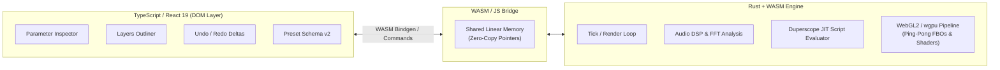

# Visualització: Rust + WASM + React Architectural Analysis

## Executive Summary

Visualització currently runs on a **Two-Plane Architecture**:
- **State Plane (React + Zustand):** Manages the Studio UI, Outliner tree, Parameter Inspector, 100-step Undo/Redo delta stack, and JSON presets.
- **Render Data Plane (TypeScript + Three.js + Web Audio):** Manages the 60 FPS WebGL render loop, FBO ping-pong feedback shaders, `@NAME` buffer pools, and expression evaluations.

Migrating the **Render Data Plane** to **Rust (compiled to WebAssembly)** while retaining **React** for the Studio UI is technically feasible and brings real benefits, but the return on investment depends heavily on **where the architectural boundary is drawn**.

---

## 1. Architectural Options: Where Does the Boundary Lie?

### Approach A: Targeted Compute in Rust (Hybrid Hotspots)
- **What stays in TypeScript/React:** UI, store, Three.js WebGL scene graph, GLSL shaders, texture management.
- **What moves to Rust:**
  - Audio DSP frequency analysis & logarithmic binning (`AudioAnalyzer`).
  - Duperscope parametric point loops (compiling and evaluating parametric formulas across 4,096 points at 60 FPS directly into a `Float32Array` view in WASM linear memory).
  - Expression parsing & AST evaluation.
- **Complexity:** Low to Medium.

### Approach B: Full Headless Render Engine in Rust (`wgpu` or `web-sys`)
- **What stays in TypeScript/React:** UI outliner, parameter inspector, preset JSON serialization, audio input stream acquisition.
- **What moves to Rust:**
  - Entire WebGL/WebGPU pipeline (`wgpu` or `web-sys` WebGL2 context).
  - Ping-pong FBO ping-pong feedback, textures, render targets.
  - Scene graph traversal and compositor passes.
- **Complexity:** High (full rewrite of the rendering and node lifecycle pipeline).

---

## 2. Pros & Cons

### Pros

1. **Massive Compute Speedup for Generative Point Loops (Track 5):**
   - In Track 5 (Duperscope), evaluating parametric scripts across 4,096 points at 60 FPS requires ~245,760 mathematical evaluations per second. In JavaScript, even optimized V8 JIT can trigger micro-stutters or de-optimizations. In Rust/WASM, tight SIMD-vectorized loops run at near-native C++ speeds.
2. **True Zero-Allocation Guarantee:**
   - In JS, accidental closures, array slicing, or object destructuring can trigger Garbage Collection (GC) pauses that drop frames below 60 FPS. Rust provides compile-time ownership, deterministic memory layouts, and zero GC overhead.
3. **Multi-Platform Portability (Desktop / Mobile Native):**
   - A Rust core can compile to WASM for the browser, but can *also* compile directly to a native desktop binary (via `wgpu` + Tauri or SDL) for a standalone 120+ FPS live VJ performance rig running on native Vulkan/Metal/DirectX.
4. **Shared Linear Memory for WebGL Attributes:**
   - Three.js `BufferAttribute` can directly wrap a typed view over WASM linear memory (`wasm.memory.buffer`). Points computed in Rust can be uploaded to GPU VBOs without copying memory across the JS bridge.

### Cons & Drawbacks

1. **JS $\leftrightarrow$ WASM Boundary Overhead:**
   - Calling across the WASM boundary (`wasm-bindgen`) has non-zero function-call overhead. If you call WASM hundreds of times per frame for tiny property updates, the bridging cost can outweigh the execution speedup. Communication must be batch-oriented (single tick call per frame).
2. **Three.js Ecosystem Friction:**
   - Visualització currently leverages Three.js materials, shader chunks, camera math, and WebGL state management. If the entire rendering engine moves to Rust, you either wrap raw `web-sys::WebGl2RenderingContext` or use `wgpu` (which is powerful, but loses Three.js's ecosystem of materials and helpers).
3. **Toolchain & Developer Experience Overhead:**
   - Requires `wasm-pack`, `cargo`, Rust toolchains, and dual-language debugging (Rust source maps in Chrome DevTools).
   - Hot-module reloading (HMR) for the engine becomes slower compared to Vite's instantaneous TypeScript HMR.
4. **Codebase Bifurcation:**
   - Full-stack contributors must be proficient in both modern React/TypeScript and Rust memory safety / borrow semantics.

---

## 3. Cost of Conversion (Engineering Estimates)

| Component | Scope | Estimated Effort | Risk Level |
| :--- | :--- | :--- | :--- |
| **Toolchain & Scaffolding** | `wasm-pack`, Vite WASM plugin, CI/CD pipeline, shared memory contracts | 12 – 16 hours | Low |
| **Audio DSP & FFT in Rust** | FFT processing, logarithmic binning, tempo estimation | 16 – 24 hours | Low |
| **Expression Engine in Rust** | AST parsing, sandboxed mathematical evaluation, scope dictionaries | 24 – 32 hours | Medium |
| **Duperscope Generative Engine** | Multi-statement JIT runner, per-point vertex loop writing to linear buffer | 24 – 36 hours | Medium |
| **FBO Ping-Pong & Feedback (if fully rewritten in Rust)** | Replacing Three.js FBO render passes with `wgpu` or raw WebGL2 | 60 – 80 hours | **High** |
| **React $\leftrightarrow$ Rust Bridge** | Batch command buffers, dirty state sync, store integration | 20 – 30 hours | Medium |
| **Test Suite Porting & Parity** | Porting 289 tests, headless WASM testing | 20 – 30 hours | Low |
| **Total (Approach A: Hybrid Compute)** | **~75 – 100 Engineering Hours** | | **Moderate** |
| **Total (Approach B: Full Rewrite)** | **~180 – 240 Engineering Hours** | | **High** |

---

## 4. Other Thoughts & Strategic Recommendation

### 1. Does the Current TypeScript Engine Actually Suffer from Bottlenecks?
Right now, Visualització maintains a rock-solid **60.0 FPS** with **0 frame drops** and **0 per-frame allocations**:
- WebGL rendering is GPU-bound (fragment shaders for ping-pong feedback).
- The TypeScript engine already uses pre-allocated `Float32Array` buffers and static `FrameContext` structs.
- Vite builds in 2.3 seconds, and tests run in parallel in ~12 seconds.

### 2. The Ideal Pragmatic Path: "Extract, Don't Rewrite"
If you want the power and elegance of Rust:
- **Do NOT rewrite the whole rendering engine in Rust today.** Rewriting Three.js FBO logic in raw WebGL/WASM is high friction with little visual benefit since the GPU does the heavy shader work anyway.
- **Best Candidate for Rust:** **The Duperscope script runner in Track 5.**
  - If we want users to run complex generative scripts (e.g., thousands of particle equations with trigonometric chaos theory or audio convolution), compiling user scripts to WebAssembly or running them via a tiny, lightweight Rust evaluator inside a shared `ArrayBuffer` gives you 10x the CPU performance without touching the existing Three.js pipeline or React UI.

### 3. Native Desktop App Potential (Tauri)
Because Visualització is a visual synthesizer designed for live performance, a Rust foundation becomes **extraordinarily compelling** if you ever want to package Visualització as a low-latency, native desktop application via **Tauri** (which uses a Rust backend + React frontend).
