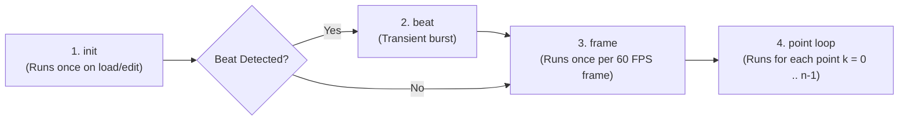

# Duperscope Generative Scripting Reference

**Duperscope** (`DuperscopeNode`) is Visualització's flagship procedural synthesis engine, inspired by Winamp AVS Superscope. It generates dynamic polyline ribbons and particle swarms by evaluating mathematical formulas across a 4-phase execution lifecycle.

---

## 🔄 The 4-Phase Execution Lifecycle



1. **`init` Phase**:
   - Executes once when the preset loads or when scripts are edited.
   - Used to configure point density (`n = 360;`), initialize accumulator angles (`angle = 0;`), and define persistent user variables.
2. **`beat` Phase**:
   - Executes strictly before `frame` only on frames where a transient musical beat is detected (`$BEAT == 1.0`).
   - Used for explosive step jumps, color inversions, and rhythmic phase shifts.
3. **`frame` Phase**:
   - Executes once per rendered frame (60 FPS).
   - Used to advance continuous rotation (`angle = angle + 0.015;`), modulate uniform colors (`r = 0.2 + $TREBLE * 0.8;`), and update global frame transforms.
4. **`point` Phase**:
   - Evaluates in an inner loop for each point index $k = 0, \dots, n-1$.
   - Populates spatial coordinates (`x`, `y`), per-point RGBA colors (`r`, `g`, `b`, `a`), and line thicknesses (`linesize`).

---

## 📝 Script Syntax & Statement Delimiters

- Multiple statements are separated by semicolons (`;`) or newlines.
- Single-line comments start with `//` and are automatically stripped.
- Assignments follow the syntax `variable = expression;`.

```javascript
// Example Duperscope Script Block
n = 360;
angle = 0;
speed = 0.02;
```

---

## 📌 Variable Scope & Read/Write Rules

### 1. Local Point Variables (Available in Scope)

| Variable | Description | Writable Phases | Default | Notes |
| :--- | :--- | :--- | :--- | :--- |
| **`n`** | Total point density ($1$ to $4096$) | `init`, `beat`, `frame` | `200` | Read-only in `point` phase |
| **`i`** | Normalized point progress ($k / (n - 1)$) | **Read-Only** | $0.0 \dots 1.0$ | Automatically calculated per point |
| **`v`** | Audio sample amplitude at progress `i` | **Read-Only** | $[-1.0, 1.0]$ | Waveform or FFT frequency energy |
| **`x`** | Horizontal screen coordinate | `point` | `0.0` | NDC range $[-1.0, 1.0]$ (1:1 aspect corrected) |
| **`y`** | Vertical screen coordinate | `point` | `0.0` | NDC range $[-1.0, 1.0]$ |
| **`r`** | Red color component | `beat`, `frame`, `point` | `1.0` | Clamped $[0.0, 1.0]$ |
| **`g`** | Green color component | `beat`, `frame`, `point` | `1.0` | Clamped $[0.0, 1.0]$ |
| **`b`** | Blue color component | `beat`, `frame`, `point` | `1.0` | Clamped $[0.0, 1.0]$ |
| **`a`** | Alpha opacity | `beat`, `frame`, `point` | `1.0` | Clamped $[0.0, 1.0]$ |
| **`linesize`** | Ribbon thickness in screen pixels | `beat`, `frame`, `point` | `1.0` | Clamped $[0.5, 128.0]$ pixels |
| **`skip`** | Discard point flag | `point` | `0.0` | Set `skip = 1` to break ribbon segment |

### 2. User-Defined Custom Variables
Any custom variable assigned in `init`, `beat`, or `frame` persists in memory across frames (e.g. `angle`, `phaseOffset`, `targetRadius`).

### 3. Read-Only System Variables
All `$SYSTEM` variables (`$TIME`, `$BASS`, `$MID`, `$TREBLE`, `$BEAT`, `$ASPECT`, etc.) and mathematical constants (`PI`, `E`) are readable in all phases but **cannot be assigned**.

---

## 🎨 Draw Modes & Shaders

1. **`lines` (Segmented Ribbon)**:
   - Draws instanced screen-space quad ribbons connecting points $p_0 \to p_1 \to \dots \to p_{n-1}$.
   - Supports line thickness from 1px to 128px with smooth aspect-ratio preservation.
2. **`lineLoop` (Closed Ribbon)**:
   - Same as `lines`, but automatically connects the final point $p_{n-1}$ back to $p_0$ to form a seamless closed loop (ideal for circular tunnels and Lissajous rings).
3. **`points` (Particle Swarm)**:
   - Renders each point as an independent circular particle disc with smooth anti-aliased edge falloff.
   - `linesize` sets the diameter of each circular particle in pixels.

---

## 🎼 Curated Generative Recipes

### Recipe 1: Oscilloscope Tunnel (`lineLoop`, `waveform`)
Pulsating circular tunnel reacting to bass and audio waveform ripples:
```text
[init]
n = 360;
angle = 0;

[beat]
angle = angle + 0.1;

[frame]
angle = angle + 0.015;
r = 0.1 + $TREBLE * 0.9;
g = 0.7;
b = 1.0;
linesize = 3.0;

[point]
theta = i * 2 * PI;
radius = 0.5 + (v * 0.25) + ($BASS * 0.15);
x = cos(theta + angle) * radius;
y = sin(theta + angle) * radius;
```

### Recipe 2: Frequency Spectrum Ribbon (`lines`, `spectrum`)
Logarithmic frequency spectrum visualizer spreading low bass to high treble from left to right:
```text
[init]
n = 256;

[beat]
boost = 1.5;

[frame]
boost = 1.0;
r = 1.0;
g = 0.3 + $MID * 0.7;
b = 0.1 + $BASS * 0.9;
linesize = 4.0;

[point]
x = i * 2.0 - 1.0;
y = -0.6 + (v * 1.2 * boost);
r = i;
b = 1.0 - i;
```

### Recipe 3: Reactive Lissajous Figure (`lineLoop`, `waveform`)
Intricate geometric Lissajous knot that morphs harmonics on beats:
```text
[init]
n = 500;
freqA = 3;
freqB = 4;
phase = 0;

[beat]
freqA = (freqA % 7) + 2;
phase = phase + 0.5;

[frame]
phase = phase + 0.02;
r = 0.9;
g = 0.4 + $MID * 0.6;
b = 0.8;
linesize = 2.5;

[point]
t = i * 2 * PI;
x = sin(t * freqA + phase) * (0.7 + v * 0.2);
y = sin(t * freqB) * (0.7 + $BASS * 0.15);
```
