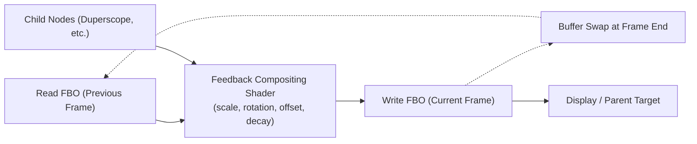
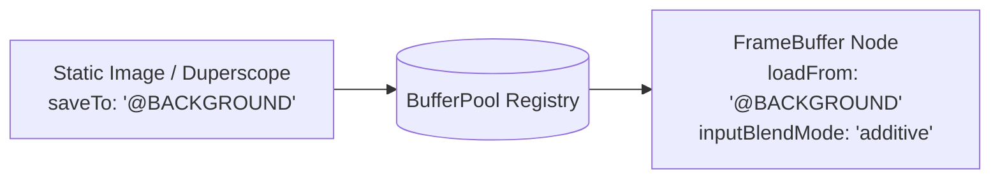

# Frame Buffer Compositing & Feedback Reference

The **Frame Buffer** (`FrameBufferNode`) is the foundational compositing primitive in Visualització. It provides offscreen texture rendering (`THREE.WebGLRenderTarget`), dual-FBO ping-pong feedback motion trails, GLSL blend modes, and global named buffer routing (`@NAME`).

---

## 🔁 Dual-FBO Ping-Pong Feedback

Ping-pong feedback is the cornerstone of classic AVS / MilkDrop visual aesthetics (infinite tunnels, smoke trails, phosphor decay, and geometric echoes).



### Enabling Ping-Pong Feedback on a Frame Buffer
Set `params.feedback: true` on the `frameBuffer` node:

```json
{
  "id": "vortex-buffer",
  "type": "frameBuffer",
  "label": "Infinite Vortex",
  "params": {
    "feedback": true,
    "outputBlendMode": "replace",
    "opacity": 0.94,
    "scale": 1.02,
    "rotation": 0.4,
    "positionX": 0.0,
    "positionY": 0.0
  },
  "children": [
    {
      "id": "inner-scope",
      "type": "duperscopeNode",
      "params": { ... }
    }
  ]
}
```

### Feedback Modulation Parameters
All feedback modulation parameters accept either static numbers or **dynamic mathematical expressions**:

| Parameter | Type | Default | Description | Typical Use |
| :--- | :--- | :--- | :--- | :--- |
| **`opacity`** | `number \| string` | `1.0` | Trail decay retention factor ($0.0 \dots 1.0$) | `0.92 + $TREBLE * 0.06` |
| **`scale`** | `number \| string` | `1.0` | Zoom factor applied to historical feedback | `1.02` (zoom out), `0.98` (zoom in) |
| **`rotation`** | `number \| string` | `0.0` | Angular rotation in degrees per frame | `0.5` (slow clockwise spiral) |
| **`positionX`** | `number \| string` | `0.0` | Horizontal drift in normalized units | `sin($TIME) * 0.01` |
| **`positionY`** | `number \| string` | `0.0` | Vertical drift in normalized units | `0.005` (rising smoke) |

---

## 🎨 Compositing Blend Modes

Visualització includes a custom GLSL full-screen quad compositing shader supporting 6 blend modes for blending child layers and feedback textures:

| Blend Mode | Formula | Visual Behavior |
| :--- | :--- | :--- |
| **`replace`** | $C_{\text{out}} = C_{\text{blend}}$ | Opaque overwrite; standard canvas rendering. |
| **`additive`** | $C_{\text{out}} = \min(1, C_{\text{base}} + C_{\text{blend}})$ | Neon glow, light accumulation, laser flares. |
| **`maximum`** | $C_{\text{out}} = \max(C_{\text{base}}, C_{\text{blend}})$ | Peak hold, lightning bolts, bright starfields. |
| **`minimum`** | $C_{\text{out}} = \min(C_{\text{base}}, C_{\text{blend}})$ | Inverted silhouette masking, dark shadows. |
| **`subtractive`**| $C_{\text{out}} = \max(0, C_{\text{base}} - C_{\text{blend}})$ | Dynamic color inversion, laser burn-in cuts. |
| **`multiplicative`** | $C_{\text{out}} = C_{\text{base}} \times C_{\text{blend}}$ | Color grading, vignette darkening, stencils. |

---

## 🏷️ Named Buffers (`@NAME`) & Buffer Routing

Any `frameBuffer` or `staticImage` can publish its output texture into the global `BufferPool` registry by assigning a `saveTo` tag, and other buffers can sample from it using `loadFrom`.



### Buffer Tag Rules
1. Tags start with `@` (e.g. `@MAIN`, `@PARTICLES`, `@WARP`).
2. Buffer dependencies are validated at runtime with cycle detection to prevent deadlocks.
3. If an input buffer is pending or unready, a 1x1 neutral black fallback texture is safely provided.

---

## ⚡ Performance Strategy: FrameBuffers vs. Geometry Scripting

When designing visual presets, it is important to choose the right tool for the job to conserve battery and memory:

* **Use Duperscope Geometry Scripting For**:
  - Mirroring, flipping, rotating, or duplicating lines, ribbons, or particle swarms.
  - *Why*: Modern CPUs evaluate 1,000–4,000 points in $< 0.08\text{ ms}$ ($< 0.5\%$ of the frame budget). Drawing them directly in the master buffer requires $< 1\text{ MB}$ VRAM and runs in **1 single GPU render pass** without context switching.
* **Use FrameBuffers For**:
  - True **texture-space transformations**: recursive ping-pong feedback (trails, smoke, infinite vortexes), multi-pass blur, or compositing disparate visual layers with GLSL blend modes.
  - *Why*: Each offscreen `FrameBuffer` allocates 8–33 MB of VRAM per target and forces the GPU to flush tile caches and switch render targets. Save this power for effects that vector math cannot achieve.
